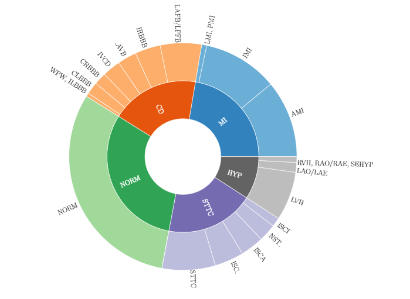
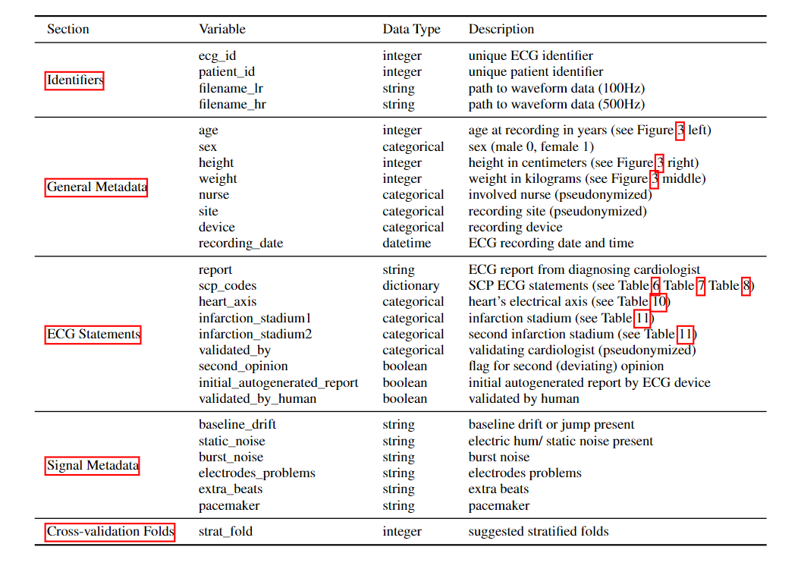
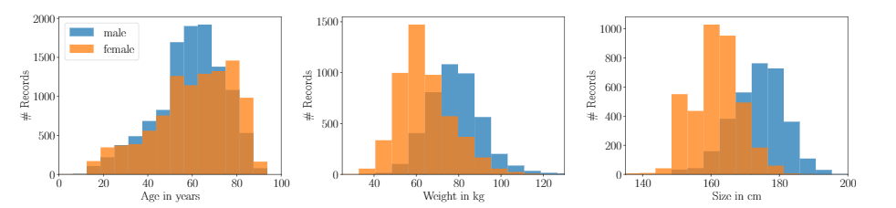

> **Published at ETNCC 2024 · IEEE** · DOI: [10.1109/ETNCC63262.2024.10767459](https://doi.org/10.1109/ETNCC63262.2024.10767459)

## Headline numbers

- **80% classification accuracy**
- **90% ROC-AUC**, the best of all six models tested
- **21,837 ECG records** · 18,885 patients · 12-lead · PTB-XL dataset

## What it is

ECG-Lense is the deep CNN architecture I built and benchmarked against five other models for classifying cardiac ECG signals. Three classical ML, three deep learning, head-to-head on the same dataset and same metrics. ECG-Lense wins.

| Model | Type |
|---|---|
| Decision Tree | Classical |
| Random Forest | Classical |
| Logistic Regression | Classical |
| Simple CNN | Deep |
| LSTM | Deep |
| **ECG-Lense (Complex CNN)** | **Deep (proposed)** |

## What I actually did

- Worked off the [PTB-XL dataset](https://physionet.org/content/ptb-xl/1.0.3/): clinical 12-lead ECGs, 10 seconds each, sampled at 100 Hz, with hierarchical diagnostic labels (5 superclasses, 24 subclasses)
- Preprocessed signals with `wfdb` and standard ML libraries
- Implemented a stationary wavelet transform (SWT) for **data augmentation**. The dataset is imbalanced and the augmentation increased sample diversity while preserving signal characteristics
- Trained the deep models on raw ECG signals so feature extraction would be automatic
- Evaluated on accuracy, precision, recall, F1, and ROC-AUC

## What broke and what I learned

- **Class imbalance was the actual problem.** First CNN runs hit a wall around 70% accuracy because rare cardiac classes were under-represented. SWT-based augmentation unlocked the next 10 points.
- **Raw signals beat hand-crafted features.** Classical ML on extracted features stalled. The deep models, given raw signals, found patterns the feature engineering had thrown away.
- **More layers wasn't the answer.** ECG-Lense is "complex" relative to the simple CNN baseline, but each block earns its place. Depth for depth's sake didn't help.

Six months of work. A+ thesis grade. Submitted to IEEE during the project, accepted, presented and published at ETNCC 2024.

## Stack

Python · TensorFlow · Keras · scikit-learn · MLFlow · `wfdb` · NumPy · pandas

## Acknowledgements

Mentor: **Dr. Kamal Kant Hiran** (PhD). He pushed me to write the paper, guided the work end-to-end.
Supervisors: **Alok Kumar**, **Dr. Chandani Joshi**, **Harsh Bansal**.

## Dataset images

- The dataset comprises 21,837 clinical 12-lead ECG records of 10 seconds in length from 18,885 patients. Hierarchical diagnostic organization: 5 superclasses, 24 sub-classes.

- Metadata in `ptbxl_database.csv`: each ECG identified by a unique `ecg_id` with SCP codes for multi-label classification.

- Demographic overview of patients in PTB-XL.

- The dataset comprises 21837 clinical 12-lead ECG records of 10 seconds in length from 18885 patients.
For the diagnostic labels, it provides a hierarchical organization in terms of 5 coarse superclasses and 24 sub-classes for the diagnostic labels

- Columns provided in the metadata table ptbxl_database.csv. Each ECG is identified by a unique ID (ecg_id) and comes with several ECG statements (scp_codes) that can be used to train a multi-label classifier that can be evaluated based on the proposed fold assignments (strat_fold).

- Demographic overview of patients in PTB-XL.

